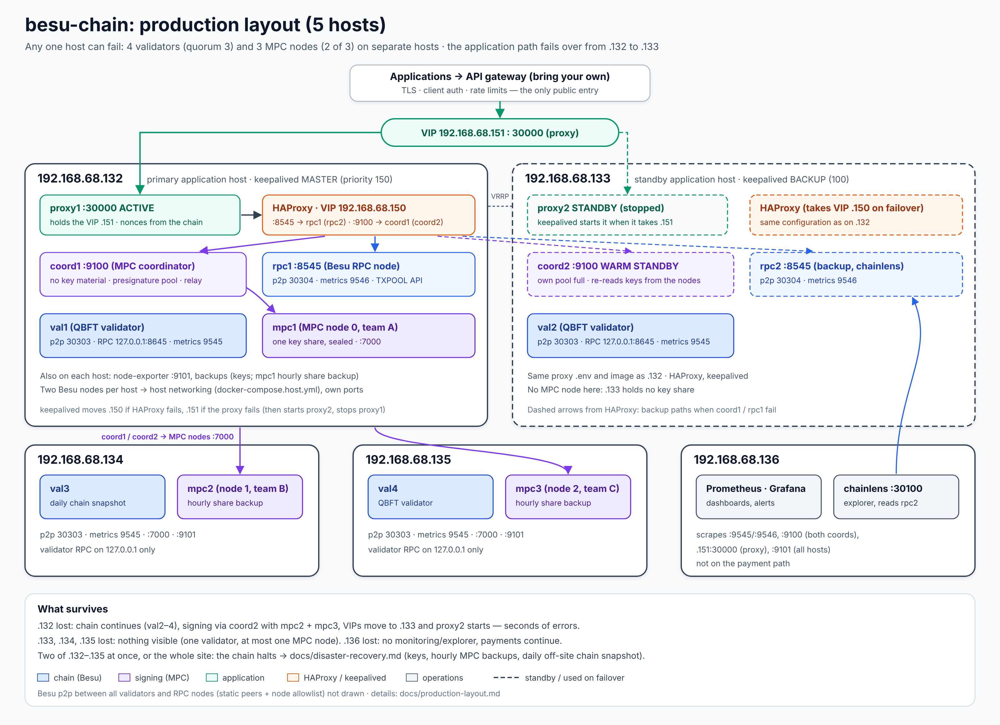

# Production layout: 5 hosts, high availability

The production deployment of this repository, host by host: what runs where, the exact settings,
the ports, the order to deploy, what survives which failure, and how to migrate from the earlier
layout. Each component's own guide has the details:
[`besu-production/README.md`](../besu-production/README.md),
[`mpc-signer/docs/production.md`](../mpc-signer/docs/production.md),
[`docs/proxy-with-mpc-signer.md`](proxy-with-mpc-signer.md), [`ha/README.md`](../ha/README.md),
[`monitoring/README.md`](../monitoring/README.md),
[`docs/disaster-recovery.md`](disaster-recovery.md).



## 1. Hosts

| Host | Runs | Role |
|---|---|---|
| **192.168.68.132** | val1, **rpc1**, **coord1**, **proxy1** (active), mpc1, HAProxy + keepalived | primary application host |
| **192.168.68.133** | val2, **rpc2**, **coord2** (warm standby), **proxy2** (standby, stopped), HAProxy + keepalived | takes over the application path when .132 fails |
| **192.168.68.134** | val3, mpc2 | validator + MPC node; daily chain snapshot |
| **192.168.68.135** | val4, mpc3 | validator + MPC node |
| **192.168.68.136** | Prometheus, Grafana, chainlens | monitoring and explorer (not on the payment path) |
| every host | node-exporter (`:9101`) | host metrics and backup results |

**Floating IPs** (keepalived, on .132 normally, .133 after a failover):

| VIP | Serves | Used by |
|---|---|---|
| `192.168.68.150` | HAProxy: `:8545` → rpc1 (rpc2 as backup), `:9100` → coord1 (coord2 as backup) | proxies (`BESU_IP`, `WEB3SIGNER_IP`, `MPC_ADMIN_URL`), coordinators (`MPC_BESU_RPC`) |
| `192.168.68.151` | `:30000` → the active proxy | applications, Prometheus (proxy job) |

```
                applications ──► 192.168.68.151:30000 (proxy VIP)
                                       │
                 ┌─────────────────────┴───────────────────────┐
     ┌── .132 ───┴──────────────┐              ┌── .133 ───────┴───────────┐
     │ proxy1 (active)          │              │ proxy2 (stopped: standby) │
     │ HAProxy ◄── VIP .150 ──► │◄── keepalived ──►│ HAProxy               │
     │   :8545 → rpc1 | rpc2    │              │                           │
     │   :9100 → coord1 | coord2│              │                           │
     │ rpc1  coord1  val1  mpc1 │              │ rpc2  coord2  val2        │
     └──────────────────────────┘              └───────────────────────────┘
     ┌── .134 ──────┐  ┌── .135 ──────┐  ┌── .136 ─────────────────────────┐
     │ val3  mpc2   │  │ val4  mpc3   │  │ Prometheus  Grafana  chainlens  │
     └──────────────┘  └──────────────┘  │ (chainlens reads rpc2)          │
                                         └─────────────────────────────────┘
     QBFT: 4 validators, quorum 3 · MPC: 3 nodes, threshold 2 · one of each per host (.132–.135)
```

## 2. Settings per component

### Besu nodes (`besu-production/node`, one directory per node)

| Node | Host | Directory (example) | `BESU_ROLE` | `P2P_PORT` | `METRICS_PORT` | `RPC_BIND_IP:RPC_PORT` | `WS_PORT` | `COMPOSE_FILE` |
|---|---|---|---|---|---|---|---|---|
| val1 | .132 | `/opt/besu-val1` | validator | 30303 | 9545 | `127.0.0.1:8645` | 8646 | `docker-compose.host.yml` |
| rpc1 | .132 | `/opt/besu-rpc1` | rpc | 30304 | 9546 | `192.168.68.132:8545` | 8546 | `docker-compose.host.yml` |
| val2 | .133 | `/opt/besu-val2` | validator | 30303 | 9545 | `127.0.0.1:8645` | 8646 | `docker-compose.host.yml` |
| rpc2 | .133 | `/opt/besu-rpc2` | rpc | 30304 | 9546 | `192.168.68.133:8545` | 8546 | `docker-compose.host.yml` |
| val3 | .134 | `/opt/besu-val3` | validator | 30303 | 9545 | `127.0.0.1:8545` | 8546 | default |
| val4 | .135 | `/opt/besu-val4` | validator | 30303 | 9545 | `127.0.0.1:8545` | 8546 | default |

Every node: `NODE_NAME` = the node's name, `P2P_HOST` and `BIND_IP` = its host's IP.
`BESU_HOST_ALLOWLIST` on the RPC nodes:

- rpc1: `192.168.68.132,192.168.68.150,localhost,127.0.0.1`
- rpc2: `192.168.68.133,192.168.68.150,localhost,127.0.0.1` (chainlens calls it on `.133`)

Validators: `tx-pool-max-future-by-sender=2000` (in `validator.toml`). Two nodes on one host need
host networking (`docker-compose.host.yml`), so they can peer with each other.

### MPC (`mpc-signer/deploy`)

| Component | Host | Settings |
|---|---|---|
| mpc1 | .132 | `MPC_NODE_ID=0`, `MPC_BIND_IP=192.168.68.132`, port 7000 |
| mpc2 | .134 | `MPC_NODE_ID=1`, `MPC_BIND_IP=192.168.68.134` |
| mpc3 | .135 | `MPC_NODE_ID=2`, `MPC_BIND_IP=192.168.68.135` |
| `cluster.json` | everywhere | urls `http://192.168.68.132:7000`, `…134:7000`, `…135:7000` (`deploy/cluster.example.json`); identical on all nodes and coordinators |
| coord1 | .132 | `MPC_BIND_IP=192.168.68.132`, `MPC_RELAY_URL=ws://192.168.68.132:9100/relay`, `MPC_BESU_RPC=http://192.168.68.150:8545` |
| coord2 | .133 | `MPC_BIND_IP=192.168.68.133`, `MPC_RELAY_URL=ws://192.168.68.133:9100/relay`, `MPC_BESU_RPC=http://192.168.68.150:8545` |

Both coordinators: the same tokens (`MPC_NODE_TOKEN`, `MPC_ADMIN_TOKEN`, `MPC_METRICS_TOKEN`),
`MPC_POOL_KEYS=<SENDER01>`. Both run all the time: HAProxy sends requests to coord1, and coord2
keeps its own presignature pool full, ready to take over. A coordinator re-reads the key list from
the MPC nodes when it meets an account it doesn't know, for `eth_accounts`, and every 30 s, so an
account created through one coordinator signs at once through the other. It needs only 2 of the 3
nodes to start.

Each MPC node keeps being run by its **own team** (one per host .132, .134, .135); no person or
storage holds two shares.

### Proxy (`proxy/`, on .132 and .133)

Same `.env` on both (`proxy/.env.example`): `BESU_IP=192.168.68.150`, `WEB3SIGNER_IP=192.168.68.150`
(port 9100), `MPC_ADMIN_URL=http://192.168.68.150:9100`, `SENDER01`, `MPC_ADMIN_TOKEN`. Only the
host holding `192.168.68.151` runs it: keepalived starts and stops it (`ha/proxy-start.sh`,
`ha/proxy-stop.sh`). A starting proxy takes its nonces from the chain, so a failover needs no state.

### HAProxy and keepalived (.132, .133)

`ha/haproxy.cfg` (identical on both), `ha/keepalived-132.conf` / `ha/keepalived-133.conf`, and the
three scripts. Steps: [`ha/README.md`](../ha/README.md).

### Chainlens and monitoring (.136)

- chainlens: `BESU_RPC=http://192.168.68.133:8545` (rpc2, so explorer polling stays off rpc1).
- monitoring: `BIND_IP=192.168.68.136`; the target files in `monitoring/prometheus/targets/` are set
  for this layout (6 Besu nodes, coord1 and coord2 on their own IPs, the proxy on its VIP, 5 hosts).

## 3. Ports and firewall

`ha/firewall-layout.sh` applies these rules with firewalld on each host
(`CLIENTS="…" ADMIN=… ./firewall-layout.sh 132`):

| Port | On | From |
|---|---|---|
| 30303, 30304 tcp+udp | Besu p2p on .132–.135 | the other Besu hosts |
| 9545, 9546 | Besu metrics | .136 |
| 8545 | rpc1 / rpc2 (and the VIP `.150`) | .132, .133 (HAProxy, proxies, coordinators), .136 (chainlens), admin |
| 9100 | coord1 / coord2 (and the VIP `.150`) | .132, .133, the MPC nodes (relay), .136 (metrics), admin |
| 7000 | mpc1 / mpc2 / mpc3 | .132, .133 (coordinators) |
| 30000 | proxy (and the VIP `.151`) | application clients, .136, admin |
| VRRP (protocol 112) | .132 ↔ .133 | each other |
| 9101 | node-exporter on every host | .136 |
| 3000, 30100 | Grafana, chainlens on .136 | admin; clients for chainlens |
| 22 | every host | admin / bastion |

## 4. Deploying from scratch

| Step | What | Guide |
|---|---|---|
| 1 | hosts: Docker + Compose, `chrony` (synchronized clocks), firewall (`ha/firewall-layout.sh`), node-exporter on every host | [`monitoring/README.md`](../monitoring/README.md) |
| 2 | **MPC:** init mpc1/2/3 (each team), `cluster.json`, coord1 + coord2, key ceremony on coord1 → `SENDER01` | [`mpc-signer/docs/production.md`](../mpc-signer/docs/production.md) |
| 3 | **Besu:** `init.sh` for the 6 nodes (settings above), operator `make-network.sh` with the 6 JSON files and `ALLOC="<SENDER01>=…"`, distribute, `start.sh` (validators first) | [`besu-production/README.md`](../besu-production/README.md) |
| 4 | **HA:** HAProxy + keepalived on .132 and .133; check the VIPs answer | [`ha/README.md`](../ha/README.md) |
| 5 | **Proxy** on .132 and .133 (same `.env`); keepalived starts it on the VIP holder | [`docs/proxy-with-mpc-signer.md`](proxy-with-mpc-signer.md) |
| 6 | **Monitoring + chainlens** on .136 | [`monitoring/README.md`](../monitoring/README.md) |
| 7 | **Backups:** `backup-key.sh` on all 6 Besu nodes, MPC `backup.sh` hourly on .132/.134/.135, `snapshot-chain.sh` daily on **val3 (.134)** with `COPY_TO` | [`docs/disaster-recovery.md`](disaster-recovery.md) |
| 8 | **Failover tests** (section 6), then go live | [`ha/README.md`](../ha/README.md) |

## 5. What survives a failure

| Lost | Chain (4 validators, quorum 3) | Signing (MPC 2 of 3) | Application path | Effect |
|---|---|---|---|---|
| **.132** | ✅ val2–val4 | ✅ mpc2 + mpc3 via coord2 | ✅ VIPs move to .133: HAProxy → rpc2 + coord2, proxy2 starts | a few seconds of failed requests |
| **.133** | ✅ | ✅ | ✅ already on .132 | none (redundancy lost until it's back) |
| **.134** | ✅ | ✅ mpc1 + mpc3 | ✅ | none; the daily snapshot moves to another validator meanwhile |
| **.135** | ✅ | ✅ mpc1 + mpc2 | ✅ | none |
| **.136** | ✅ | ✅ | ✅ | no monitoring, no explorer |
| **two of .132–.135** | ❌ halts (2 of 4) | ❌ if both had MPC nodes | — | [`docs/disaster-recovery.md`](disaster-recovery.md) |
| .132 **and** .133 | ❌ halts (val3 + val4 = 2 of 4) | ❌ mpc2 + mpc3 alive, but no coordinator | ❌ | DR runbook |

Planned maintenance: never take two of .132–.135 down at once.

## 6. Failover tests (before going live, then twice a year)

| Test | Do | Expect |
|---|---|---|
| RPC | stop rpc1 | HAProxy uses rpc2 within ~6 s; transfers keep working |
| Coordinator | stop coord1 | signing via coord2 at once (warm pool); new accounts sign too |
| Proxy | stop proxy1 | VIP `.151` moves to .133, proxy2 starts, `/status/senders` answers on `.151` |
| HAProxy | `systemctl stop haproxy` on .132 | VIP `.150` moves to .133 |
| Host | power off .132 | both VIPs on .133; chain continues; a few seconds of errors |
| Validator | stop one validator | blocks continue; `BesuNodeDown` alert |
| MPC node | stop mpc2 | signing continues; `MpcNodeDown` alert |

After each test, start the component again and wait until Grafana shows everything up before the
next one.

## 7. Migrating from the earlier layout

Earlier: .132 = val1, val2, rpc1, coordinator, proxy; .133 = val3; .134 = val4 (+ an MPC node).
Target: as in section 1. Nodes keep their **keys**; only their host changes. Rules:

- **Never run one key on two hosts at the same time.** Stop the old node before starting it on the
  new host.
- **One validator at a time.** With 4 validators, the chain tolerates one being down.
- Free a host before moving a node onto it, so the order is: val4 → .135, then val3 → .134, then
  val2 → .133.

**Prepare:** set up .135 and .136 (step 1 in section 4), back up all node keys (`backup-key.sh`).

**Move one validator** (e.g. val4 from .134 to .135); the operator:

```bash
cd /secure/network            # the operator's copy of the 4 network files
/path/to/besu-production/operator/move-node.sh . validator4.json 192.168.68.135:30303
```

1. Copy the 4 updated files to **every** node and restart the **other** nodes one at a time
   (`./start.sh && docker compose restart`, wait for peers).
2. Stop val4 on .134: `docker compose down` (keep its volume until the move is verified).
3. On .135: node package, `.env` with `P2P_HOST`/`BIND_IP=192.168.68.135`, the 4 network files,
   `./restore-key.sh validator4.key`, `./start.sh`. Check `qbft.sh health`: blocks rising, all peers.
4. Repeat for val3 (.133 → .134), then val2 (.132 → .133, with the ports in section 2).

**Add rpc2** (.133): `init.sh` (settings above), operator `add-node.sh network/ rpc2.json`,
distribute, restart the others one at a time, start rpc2.

**MPC nodes:** move each to its target host with its own backup: on the new host the same `.env`
(same `MPC_NODE_ID` and passphrase), `restore.sh`, start; update its `url` in `cluster.json`, copy
`cluster.json` to all nodes and coordinators, restart them one at a time. Never two at once.

**Then:** coord2 on .133, HAProxy + keepalived, proxy2, the new proxy `.env` (VIPs), monitoring +
chainlens on .136, the new monitoring targets, backups, and the failover tests.
