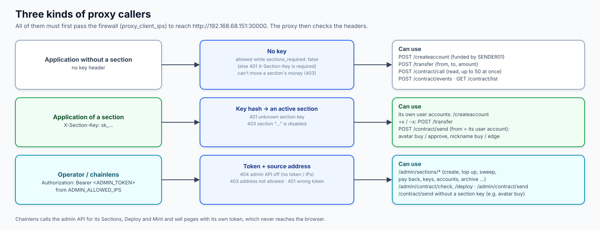

# 프록시 API 레퍼런스

> **내용:** 프록시(`proxy/stress-latest.js`)의 모든 엔드포인트와 요청 본문, 응답입니다.
>
> **대상:** 애플리케이션 개발자 및 운영자.
>
> **관련 문서:** [프록시 구성 요소](../components/proxy.md) · [섹션](../features/sections.md) ·
> [아바타](../features/avatars.md) · [닉네임](../features/nicknames.md) · [용어집](../glossary.md)

**목차**

- [규칙](#conventions)
- [계정과 이체](#accounts-and-transfers)
- [섹션 호출 (`X-Section-Key`)](#section-calls-x-section-key)
- [컨트랙트](#contracts)
- [아바타 컬렉션](#avatar-collections)
- [닉네임](#nicknames)
- [관리 API: 섹션](#admin-api-sections)
- [관리 API: 컨트랙트와 레지스트리](#admin-api-contracts-and-registry)
- [제거된 라우트](#removed-routes)
- [상태와 메트릭](#status-and-metrics)
- [오류](#errors)

---

## 규칙 {#conventions}



| | |
|---|---|
| **기본 URL** | `http://<proxy VIP>:30000` — 프로덕션 `http://192.168.68.151:30000`(활성 프록시). 개발: `http://localhost:30000` |
| **본문** | JSON, 헤더 `Content-Type: application/json` (제한 1 MB) |
| **금액** | ETH를 십진수 문자열로 표기(`"1.5"`), wei는 사용하지 않습니다. 예외: 목록 형태 `args`의 원시 ABI 값([아래](#arguments-a-list-or-an-object)) |
| **주소** | `0x…` (대소문자 무관) |
| **응답** | JSON. 성공: `{ "success": true, … }`. 실패: HTTP 상태 코드와 `{ "error": "…" }` |
| **호출 가능 대상** | 방화벽의 `proxy_client_ips` ([접근 제어](../deployment/access-control.md)). 관리 API는 관리 토큰과 관리자 주소도 필요합니다 |

호출자는 세 종류입니다.

| 호출자 | 헤더 | 사용 가능 범위 |
|---|---|---|
| 섹션이 **없는** 애플리케이션 | 없음 | SENDER01을 쓰는 `/createaccount`와 `/transfer`, 컨트랙트 읽기(`/contract/call`, `/contract/events`, `/contract/list`). `sections_required: true`이면 모두 거부(401) |
| **섹션에 속한** 애플리케이션 | `X-Section-Key: sk_…` | 섹션 호출: 자체 계정, +x / −x 이체, 컨트랙트 읽기와 쓰기(아바타 구매, 닉네임) |
| **운영자 / chainlens** | `Authorization: Bearer <ADMIN_TOKEN>`, `ADMIN_ALLOWED_IPS`에서 호출 | `/admin/*` API, 키 없는 `/contract/send` |

```bash
# example
curl -s -X POST http://192.168.68.151:30000/createaccount \
  -H 'Content-Type: application/json' -H 'X-Section-Key: sk_…' \
  -d '{"amount":"2","pool":"none"}'
```

---

## 계정과 이체 {#accounts-and-transfers}

### `POST /createaccount` — 새 계정 (새 MPC 키) {#post-createaccount--new-account-new-mpc-key}

MPC 노드 3개가 분산 키 생성을 실행합니다. 개인 키는 어디에도 존재하지 않습니다. **MPC 노드 3개가
모두 온라인이어야 합니다.**

| 필드 | | |
|---|---|---|
| `amount` | ETH | 새 계정에 공급할 자금 |
| `pool` | 선택 사항 | 사전 서명 풀 등급: `big`, `small`(기본값, `MPC_NEW_ACCOUNT_POOL`) 또는 `none`. `big` = 사용량이 많은 계정을 위한 빠른 서명 |

- **`X-Section-Key`가 있는 경우:** 계정이 온체인에서 해당 섹션 아래에 등록되고, 섹션의
  **선지급** 계정에서 자금을 받습니다.
- **키가 없는 경우:** `SENDER01`이 자금을 공급합니다.

```json
→ { "success": true, "section": { "id": 1, "name": "Shop A" }, "address": "0x…",
    "from": "<upfront account>", "amount": "2", "txHash": "0x…", "registryTxHash": "0x…" }
```

### `POST /account/pool` — 계정의 풀 등급 변경 {#post-accountpool--change-an-accounts-pool-class}

`{ "address": "0x…", "pool": "big" | "small" | "none" }`

### `POST /transfer` — ETH 이동 {#post-transfer--move-eth}

**섹션 호출**(`X-Section-Key`): `amount`의 부호가 방향을 정합니다.

| 본문 | 방향 |
|---|---|
| `{ "account": "0x…", "amount": "1", "memo": "optional" }` | **+x**: 사용자 계정 → 섹션의 **소비** 계정 |
| `{ "account": "0x…", "amount": "-0.5" }` | **−x**: 섹션의 **선지급** 계정 → 사용자 계정 |

`account`는 해당 섹션의 사용자 계정이어야 합니다.

```json
→ { "success": true, "section": {…}, "direction": "account -> consumption",
    "from": "0x…", "to": "0x…", "amount": "1", "txHash": "0x…" }
```

**키가 없는 경우:** `{ "from": "0x…", "to": "0x…", "amount": "1", "memo": "optional" }`.
섹션의 계정은 이 방식으로 이동할 수 없습니다(403).

### `GET /transfer/:txHash` — 이체 상태 {#get-transfertxhash--status-of-a-transfer}

상태(pending, mined, failed)와 메모를 반환합니다.

---

## 섹션 호출 (`X-Section-Key`) {#section-calls-x-section-key}

키는 섹션을 식별하며, 섹션은 **활성** 상태여야 합니다. 키가 없으면 호출은 SENDER01을 사용합니다.
단, `sections_required: true`이면 401이 반환됩니다. [섹션](../features/sections.md)을 참조하십시오.

| 엔드포인트 | 섹션 키 사용 시 |
|---|---|
| `POST /createaccount` | 섹션의 계정, 섹션의 선지급 계정에서 자금 공급 |
| `POST /transfer` | +x / −x (위 참조) |
| `POST /contract/send` | 섹션의 사용자 계정이 서명하는 컨트랙트 트랜잭션. 모든 아바타 구매와 닉네임 쓰기도 포함 ([아래](#contracts)) |
| `POST /contract/call`, `/contract/events`, `GET /contract/list` | 읽기. 키는 `sections_required: true`일 때만 필요 |

---

## 컨트랙트 {#contracts}

SectionRegistry에 등록된 모든 컨트랙트(컨트랙트 계정 센터가 배포한 것)에 하나의 API를 씁니다.
해당 ABI의 함수와 이벤트만 사용할 수 있습니다. 플랫폼 자체 컨트랙트(아바타 컬렉션과 닉네임
컬렉션)도 같은 호출을 쓰며, 친화적인 값을 사용합니다.

| 엔드포인트 | 동작 | 호출자 |
|---|---|---|
| `POST /contract/call` | 읽기: view / pure 함수(`eth_call`), 한 번에 최대 50개 | 허용된 누구나 (`sections_required: true`이면 섹션 키) |
| `POST /contract/send` | 쓰기: **호출자 섹션의 사용자 계정**이 서명하는 트랜잭션 | `X-Section-Key` 또는 관리 토큰 |
| `POST /contract/events` | 컨트랙트의 이벤트, 필터 적용, 최신순 | `/contract/call`과 동일 |
| `GET /contract/list` | 등록된 컨트랙트 | `/contract/call`과 동일 |
| `POST /admin/contract/send` | **컨트랙트 계정 센터**(플랫폼 컨트랙트의 민터이자 소유자)가 서명하는 쓰기 | 관리 토큰 ([아래](#post-admincontractsend--write-as-the-contract-account-center)) |

`contract`는 컨트랙트 주소입니다. `function`은 이름이며, 이름이 오버로드된 경우 전체 시그니처
(`transfer(address,uint256)`)를 씁니다.

### 인수: 목록 또는 객체 {#arguments-a-list-or-an-object}

| `args` | 의미 | 예 |
|---|---|---|
| **목록** | 순서대로 원시 ABI 값: wei, `bytes3` 16진수, 토큰 ID… | `"args": ["1"]` |
| **객체** | **이름으로** 지정한 값 (ABI의 입력 이름. 앞뒤의 `_`는 무시) | `"args": { "tokenId": "1" }` |
| 생략 | 인수 없음 | |

숫자는 문자열 또는 숫자, 주소는 `0x…`, 불리언은 `true` / `false`, 배열과 튜플은 JSON으로 씁니다.
**플랫폼 컨트랙트**에 객체를 쓰면 값이 **친화적**입니다: ETH 가격, 민팅용 메타데이터([아래 표](#friendly-values-of-the-platform-contracts)). 다른 컨트랙트에서는
객체가 값을 ABI 순서로 놓기만 합니다.

- 빠졌거나 이름이 틀린 값: 400 `args: no value for "account" (quote(address,uint8)); given: acct`.
- 다른 컨트랙트에서 알 수 없는 이름: 400 `args: unknown name(s) x; f(uint256) takes a, b`.
- 플랫폼 컨트랙트에서 알 수 없는 이름: 400 `args: unknown name(s) color; setEdge takes level, price, forSale, enabled`.
- 닉네임은 목록에서도 항상 앞뒤 공백 제거와 NFC 정규화를 거칩니다.

### `POST /contract/call` — 읽기 {#post-contractcall--read}

```json
{ "contract": "0xCollection", "function": "priceOf", "args": { "tokenId": "1" } }
→ { "success": true, "contract": "0xCollection", "function": "priceOf(uint256)",
    "result": { "tokenId": "1", "price": "0.3" },
    "outputs": [ { "name": "0", "type": "uint256", "value": "300000000000000000" } ] }
```

`result`는 친화적인 값, `outputs`는 원시 ABI 값입니다.

**일괄 처리:** `{ "calls": [ { contract, function, args }, … ] }`, 읽기 1~50개, 어떤 컨트랙트든
가능합니다. 각각 따로 응답하거나 실패합니다. 모두 성공했을 때만 `success`가 true입니다.

```json
{ "calls": [
    { "contract": "0xCollection", "function": "ownerOf", "args": { "tokenId": "1" } },
    { "contract": "0xCollection", "function": "ownerOf", "args": ["77"] },
    { "contract": "0xCollection", "function": "name" } ] }
→ { "success": false, "results": [
    { "success": true, "function": "ownerOf(uint256)", "result": { "tokenId": "1", "owner": "0xUser" }, "outputs": […], … },
    { "success": false, "status": 400, "error": "call reverted: not minted" },
    { "success": true, "function": "name()", "result": "Dragons", "outputs": […], … } ] }
```

### `POST /contract/send` — 쓰기 {#post-contractsend--write}

호출자 섹션의 사용자 계정인 `from`이 서명합니다. 블록을 기다립니다. `value`는 ETH 단위이며
payable 함수에만 사용합니다.

```json
{ "contract": "0x…", "function": "transfer(address,uint256)", "args": ["0xTo", "5"], "from": "0xUser", "value": "0" }
→ { "success": true, "section": { "id": 1, "name": "Shop A" }, "contract": "0x…", "function": "transfer(address,uint256)",
    "from": "0xUser", "value": "0.0", "txHash": "0x…", "blockNumber": 123, "gasUsed": 51234,
    "result": null, "events": [ { "name": "Transfer", "args": {…} } ] }
```

`result`는 플랫폼 컨트랙트의 친화적인 결과(판매, 닉네임…)이며, 다른 컨트랙트에서는 `null`입니다.
`events`는 디코딩된 컨트랙트 이벤트입니다. 채굴되었지만 revert된 트랜잭션은 `success: false`와
함께 400으로 응답합니다.

- **호출자:** `X-Section-Key`, 또는 키 없이 `ADMIN_ALLOWED_IPS`에서 온 관리 토큰(chainlens 방식).
  이때 섹션은 `from`의 섹션이며, `from`은 활성 섹션의 사용자 계정이어야 합니다.
- **payee:** 이름이 `payee`인 `address` 입력은 생략하면 보내는 계정 섹션의 **소비** 계정으로
  채워집니다. 다른 주소이면 400.
- **가격:** 아래 플랫폼 함수는 `value`를 생략하면 가격으로 채워집니다. 다른 값이면 400.
- **메트릭:** 섹션 작업은 이벤트로 집계됩니다: `NicknameBought` → `nickname_sale`,
  `EdgeUpgraded` → `edge_upgrade`, `Sold` → `avatar_sale`(판매자 = 컨트랙트 계정 센터)
  또는 `avatar_resale`.

| 컨트랙트 | 함수, `args` | 채워지는 `value` | 전송 전 확인 | 이벤트 |
|---|---|---|---|---|
| 닉네임 컬렉션 | `buyNickname`, `{ nickname }` | `nicknamePrice` | 공백 제거 + NFC, 1~256자, 제어 문자와 `< > & " ' \` 불가 (400). 계정당 하나, 사용 중, 예약됨 (409) | `NicknameBought {tokenId, buyer, nickname, price, paidTo}` |
| 닉네임 컬렉션 | `upgradeEdge`, `{ level }` | `quote(from, level)` (단계 가격 합계) | 레벨 1 이상 (400). 닉네임 보유 (404). 레벨이 있고, 판매 중이며, 현재보다 높음 (400 `level N: …`) | `EdgeUpgraded {tokenId, owner, fromLevel, toLevel, price, paidTo}` |
| 아바타 컬렉션 | `buy`, `{ tokenId }` | `priceOf(tokenId)` | 토큰 존재 (404). `from`이 이미 보유하지 않음 (400) | `Sold {tokenId, seller, buyer, price, paidTo}` |
| 아바타 컬렉션 | 판매자가 `approve`, `{ tokenId }` | — | — | `Approval` |

`mint`는 이 방식으로 보낼 수 없습니다(센터만 민팅, `not minter`).
[`POST /admin/contract/send`](#post-admincontractsend--write-as-the-contract-account-center)를 사용하십시오.

### `POST /contract/events` — 이벤트 {#post-contractevents--events}

```json
{ "contract": "0xCollection", "event": "Transfer", "where": { "to": "0xUser" }, "current": true }
→ { "success": true, "contract": "0xCollection", "event": "Transfer(address,address,uint256)",
    "fromBlock": 37567, "toBlock": 37592, "count": 1, "complete": true,
    "events": [ { "name": "Transfer", "args": { "from": "0xSeller", "to": "0xUser", "tokenId": "1" },
                  "blockNumber": 37590, "txHash": "0x…", "logIndex": 0, "time": "2026-11-23T12:20:15.000Z" } ] }
```

| 필드 | |
|---|---|
| `event` | 이벤트 이름(또는 시그니처). 틀리면 목록과 함께 400 |
| `where` | `{ 인수: 값 }`. **indexed** 인수는 체인이 필터링하고, 그 밖의 인수는 디코딩 후 프록시가 필터링 |
| `fromBlock`, `toBlock` | 기본값: 컨트랙트 등록 블록부터 최신 블록까지 |
| `limit` | 기본값 100, 최대 1000. 최신 이벤트부터 |
| `current` | 이벤트 `Transfer`와 `where.to`가 있을 때만 `true`: 그 주소가 **아직 보유한** 토큰만 남김(토큰당 이벤트 하나) |

`complete: false`는 한도에 도달했다는 뜻입니다: 더 오래된 이벤트가 있습니다. 플랫폼 컨트랙트에서는
`price`와 `stepPrice`가 ETH 단위입니다.

### `GET /contract/list` — 등록된 컨트랙트 {#get-contractlist--registered-contracts}

| 쿼리 | 남기는 것 |
|---|---|
| `?type=avatar` / `nickname` / `contract` | 아바타 컬렉션, 닉네임 컬렉션, 그 밖의 컨트랙트 |
| `?kind=common` / `avatar` | 레지스트리 종류 |
| `?has=buyNickname` | 이 함수가 있는 컨트랙트 |
| `?q=drag` | 이름에 포함 (대소문자 무관) |
| `?functions=1` | 각 컨트랙트의 `functions`(시그니처, mutability)와 `events` 추가 |

```json
→ { "success": true, "contracts": [
    { "address": "0xCollection", "name": "Dragons", "type": "avatar", "kind": "avatar", "registeredIn": 14172,
      "symbol": "DRG", "minter": "<contract account center>" },
    { "address": "0xNicknames", "name": "Nicknames", "type": "nickname", "kind": "common", "registeredIn": 35444,
      "symbol": "NICK", "minter": "<contract account center>", "current": true } ],
  "center": "<contract account center>" }
```

오래된 것부터 나열합니다. `current: true`는 사용 중인 닉네임 컬렉션(가장 최근에 등록된 것)입니다.
버전 5 컬렉션만 `type: "nickname"`입니다. 이전 컬렉션(버전 4, 테두리 스타일 포함)은 일반
컨트랙트(`type: "contract"`, 친화적 값 없음)입니다.

### 플랫폼 컨트랙트의 친화적인 값 {#friendly-values-of-the-platform-contracts}

**인수**(객체 형태의 `args`). *센터* = `/admin/contract/send`에서만.

| 컨트랙트 | 함수 | `args` |
|---|---|---|
| 아바타 | `buy` | `{ tokenId }` (payee와 가격은 채워짐) |
| 아바타 | `approve` | `{ tokenId }`: 토큰을 판매에 내놓음(컬렉션 자신을 승인. 다른 주소를 승인하려면 `to`) |
| 아바타 | `priceOf`, `ownerOf`, `tokenURI`, `getApproved` | `{ tokenId }` |
| 아바타 | `balanceOf` | `{ owner }` |
| 아바타 | `mint` (센터) | `{ name, image, description, attributes, properties, price }`: `name`과 `image` 필수, `price`는 ETH(기본값 0). 소유자(센터), 다음 토큰 ID, 온체인 메타데이터 URI는 채워짐 |
| 닉네임 | `buyNickname` | `{ nickname }` |
| 닉네임 | `upgradeEdge` | `{ level }` |
| 닉네임 | `quote` | `{ account, level }` |
| 닉네임 | `isAvailable`, `idOf` | `{ nickname }` |
| 닉네임 | `nicknameOf`, `balanceOf` | `{ account }` |
| 닉네임 | `edgeInfo` | `{ level }` |
| 닉네임 | `tokenURI`, `ownerOf`, `edgeOf`, `nicknameById`, `locked`, `reserved` | `{ tokenId }` |
| 닉네임 | `setNicknamePrice` (센터) | `{ price }` (ETH) |
| 닉네임 | `addEdge` (센터) | `{ price }`: 새 레벨의 단계 가격(ETH). 판매 중으로 추가됨 |
| 닉네임 | `setEdge` (센터) | `{ level, price, forSale }`: 생략한 필드는 그대로 (`enabled`는 `forSale`의 별칭) |
| 닉네임 | `reserve` (센터) | `{ nicknames: [ … ], reserved }`: 이름 1~100개. `reserved: false`이면 해제 |

레벨에는 단계 가격과 판매 여부만 저장됩니다. 레벨 0은 항상 가격 0이고 항상 판매 중입니다.

**결과**(`result`):

| 컨트랙트 | 함수 | `result` |
|---|---|---|
| 아바타 | `priceOf` | `{ tokenId, price }` |
| 아바타 | `ownerOf` | `{ tokenId, owner }` |
| 아바타 | `tokenURI` | `{ tokenId, metadata, image }` |
| 아바타 | `balanceOf` | `{ owner, tokens }` |
| 아바타 | `buy` | `{ sale: "first sale" \| "resale", tokenId, seller, buyer, price, paidTo }` |
| 아바타 | `mint` | `{ minted, tokenId, owner, price, metadata }` |
| 아바타 | `approve` | `{ tokenId, approved, forSale }` (`forSale`: 컬렉션에 승인됨) |
| 닉네임 | `nicknamePrice` | `{ price }` |
| 닉네임 | `edgeCount` | `{ count, edges: [ { level, price, forSale } ] }` |
| 닉네임 | `edgeInfo` | 테두리 하나 `{ level, price, forSale }` |
| 닉네임 | `quote` | `{ account, level, price }`: `level`까지의 단계 가격 합계 |
| 닉네임 | `isAvailable` | `{ nickname, characters, tokenId, available, reason }` (`reason`: `taken`, `reserved` 또는 `null`) |
| 닉네임 | `idOf` | `{ nickname, tokenId }` |
| 닉네임 | `nicknameOf` | `{ nickname, tokenId, account, level }` 또는 `{ account, nickname: null }` |
| 닉네임 | `edgeOf` | `{ tokenId, level }` |
| 닉네임 | `tokenURI` | `{ tokenId, metadata }` (`metadata`: `{ name, description, attributes: [ { trait_type: "edge level", display_type: "number", value } ] }`, 이미지 없음) |
| 닉네임 | `ownerOf` | `{ tokenId, owner }` |
| 닉네임 | `buyNickname`, `upgradeEdge` | 닉네임 정보(`nicknameOf`와 같음) + `price`, `paidTo` |
| 닉네임 | `setEdge`, `addEdge` | `{ edge: { level, price, forSale } }` |
| 닉네임 | `setNicknamePrice` | `{ nicknamePrice }` |
| 닉네임 | `reserve` | `{ reserved, nicknames }` |
| 그 밖의 컨트랙트 | 읽기 | 값 하나, 또는 이름 붙은 값의 객체. JSON 데이터 URI는 디코딩 |

가격은 ETH 단위입니다.

### 컨트랙트 호출의 오류 {#errors-of-the-contract-calls}

| 상태 | 메시지(시작 부분) |
|---|---|
| 400 | `contract: a contract address` |
| 404 | `0x… is not a registered contract` |
| 400 | `function "x" is not in the contract's ABI` / `several functions have this name, give the signature …` |
| 400 | `… changes state: use POST /contract/send` / `… only reads: use POST /contract/call` |
| 400 | `args: no value for "…" (…); given: …` / `args: unknown name(s) …; setEdge takes level, price, forSale, enabled` / `args: a list (raw ABI values) or an object (by name)` |
| 400 | 친화적인 값: `price: ETH, e.g. "0.5"`, `nicknames: a list of 1 to 100 nicknames` |
| 404 | `level: no edge level 40 (levels 0-3)` (`setEdge`) |
| 400 | `call reverted: …` (읽기) / `calls: a list of 1 to 50 reads …` |
| 400 | `event: one of …` / `where: Sold has no argument …` / `current: only with event Transfer and where.to …` |
| 400 | `payee: the consumption account of section "…" (0x…); leave it out to fill it in` |
| 400 | `value: the price is X ETH (leave "value" out to pay it)` / `… is not payable: send no value` |
| 400 | `insufficient balance: X ETH is needed` |
| 400 | `the transaction would revert: …` (서명 전에 컨트랙트의 이유와 함께 거부) |
| 401 | `X-Section-Key is required: …` (키 없음, 관리 호출자도 아님) |
| 403 | `… is not a user account of a section` / `section "…" is disabled` |

---

## 아바타 컬렉션 {#avatar-collections}

**아바타**는 플랫폼의 이미지 토큰입니다. 아바타 컬렉션
([`AvatarCollection.sol`](../../proxy/contracts/AvatarCollection.sol). 버전 3 컬렉션도 같은 코드)은
**컨트랙트 계정 센터**가 배포하고 민팅하며, SectionRegistry에 등록되고(종류 avatar), 모든 섹션이
공유합니다. 가격은 민팅 시 정해지며 모든 판매에서 고정됩니다. 판매는 구매자가 서명하는 `buy`
하나이며, 토큰과 ETH는 함께 이동하거나 전혀 이동하지 않습니다.

| 작업 | 호출 |
|---|---|
| 컬렉션 목록 | `GET /contract/list?type=avatar` |
| 배포 | `POST /admin/contract/deploy` `{ "template": "avatar-collection", "name", "symbol" }` |
| 판매용 민팅 | `POST /admin/contract/send` `mint` `{ name, image, description, attributes, price }` |
| 최초 판매 | `POST /contract/send` `buy` `{ tokenId }`, `from` = 구매자: 대금은 구매자 섹션의 **소비** 계정으로 |
| 재판매 | 판매자가 `approve` `{ tokenId }`를 보낸 뒤 구매자가 `buy` `{ tokenId }`를 보냄: 대금은 **판매자**에게 |
| 계정이 보유한 토큰 | `POST /contract/events` `Transfer`, `where: { to }`, `current: true` |
| 토큰 정보 | `POST /contract/call` 일괄: `ownerOf`, `priceOf`, `tokenURI` |
| 토큰의 민팅 트랜잭션 | `POST /contract/events` `Transfer`, `where: { from: 0x0…0, tokenId }` |
| 판매 내역 | `POST /contract/events` `Sold` |

**버전 2 컬렉션**(SENDER01이 민팅)은 **폐기되었습니다**: 프록시는 더 이상 이를 읽거나, 민팅하거나,
판매하지 않습니다. 체인에는 남아 있습니다.

```bash
P=http://192.168.68.151:30000; T=<admin token>; K=<section key>
# 배포 (이름과 심볼은 아바타 컬렉션 사이에서 대소문자 무관하게 고유, 아니면 409)
curl -s -X POST $P/admin/contract/deploy -H "Authorization: Bearer $T" -H 'Content-Type: application/json' \
  -d '{"template":"avatar-collection","name":"Dragons","symbol":"DRG"}'
# → { "success": true, "name": "Dragons", "kind": "avatar", "address": "0xCollection", "txHash": "0x…", "codeCheck": "matches the artifact", … }

# 민팅 (센터가 판매용으로 자신에게 민팅)
curl -s -X POST $P/admin/contract/send -H "Authorization: Bearer $T" -H 'Content-Type: application/json' \
  -d '{"contract":"0xCollection","function":"mint","args":{"name":"Red dragon","image":"https://example.com/red.png","description":"Level 1","attributes":[{"trait_type":"level","value":"1"}],"price":"0.3"}}'
# → { "success": true, "function": "mint(address,uint256,string,uint256)", "txHash": "0x…",
#     "result": { "minted": true, "tokenId": "1", "owner": "<center>", "price": "0.3", "metadata": { "name": "Red dragon", … } }, … }

# 최초 판매 (구매자: 키 섹션의 사용자 계정)
curl -s -X POST $P/contract/send -H "X-Section-Key: $K" -H 'Content-Type: application/json' \
  -d '{"contract":"0xCollection","function":"buy","args":{"tokenId":"1"},"from":"0xUser"}'
# → { "success": true, "value": "0.3", "txHash": "0x…",
#     "result": { "sale": "first sale", "tokenId": "1", "seller": "<center>", "buyer": "0xUser", "price": "0.3", "paidTo": "<consumption account>" }, "events": [ … ] }

# 재판매: 판매자의 섹션이 판매에 내놓고, 구매자의 섹션이 구매
curl -s -X POST $P/contract/send -H "X-Section-Key: $K" -H 'Content-Type: application/json' \
  -d '{"contract":"0xCollection","function":"approve","args":{"tokenId":"1"},"from":"0xUser"}'
# → { …, "result": { "tokenId": "1", "approved": "0xCollection", "forSale": true } }
curl -s -X POST $P/contract/send -H "X-Section-Key: $K2" -H 'Content-Type: application/json' \
  -d '{"contract":"0xCollection","function":"buy","args":{"tokenId":"1"},"from":"0xBuyer"}'
# → { …, "result": { "sale": "resale", "tokenId": "1", "seller": "0xUser", "buyer": "0xBuyer", "price": "0.3", … } }

# 0xBuyer가 보유한 토큰, 토큰 1을 한 번에
curl -s -X POST $P/contract/events -H "X-Section-Key: $K" -H 'Content-Type: application/json' \
  -d '{"contract":"0xCollection","event":"Transfer","where":{"to":"0xBuyer"},"current":true}'
curl -s -X POST $P/contract/call -H "X-Section-Key: $K" -H 'Content-Type: application/json' \
  -d '{"calls":[{"contract":"0xCollection","function":"ownerOf","args":{"tokenId":"1"}},{"contract":"0xCollection","function":"priceOf","args":{"tokenId":"1"}},{"contract":"0xCollection","function":"tokenURI","args":{"tokenId":"1"}}]}'
# → results: { "tokenId": "1", "owner": "0xBuyer" }, { "tokenId": "1", "price": "0.3" }, { "tokenId": "1", "metadata": {…}, "image": "https://example.com/red.png" }
# 토큰 1의 민팅 트랜잭션
curl -s -X POST $P/contract/events -H "X-Section-Key: $K" -H 'Content-Type: application/json' \
  -d '{"contract":"0xCollection","event":"Transfer","where":{"from":"0x0000000000000000000000000000000000000000","tokenId":"1"}}'
```

토큰 ID는 각 컬렉션에서 1부터 시작합니다. 메타데이터는 토큰 URI에 온체인으로 저장됩니다(JSON.
블록에 들어가지 않으면 400 `metadata is too large for the chain`). 판매자와 구매자는 다른 섹션에
있어도 됩니다: 각 섹션은 자기 계정으로만 서명합니다. Remix에서 판매까지의 단계별 안내:
[아바타](../features/avatars.md).

### 이전 이름 {#old-names}

프록시는 *avatar*로 이름을 바꾸기 전의 이름도 계속 받습니다.

| 이전 이름 | 현재 |
|---|---|
| `?type=nft`, `?kind=nft` | `?type=avatar`, `?kind=avatar` |
| `"kind": "nft"` (deploy, check) | `"kind": "avatar"` (온체인 종류 번호는 여전히 2) |
| 템플릿 `nft-collection` | 템플릿 `avatar-collection` |

응답은 항상 새 이름을 씁니다. 메트릭의 `op` 값은 별칭 없이 바뀌었습니다: `nft_first_sale` →
`avatar_sale`, `nft_resale` → `avatar_resale`.

---

## 닉네임 {#nicknames}

테두리 레벨이 있는 소울바운드 닉네임 토큰([닉네임](../features/nicknames.md))이며, **닉네임
컬렉션**에 있습니다: 센터가 배포한 등록 컨트랙트입니다. `GET /contract/list?type=nickname`으로
찾습니다(`current: true`인 것). 가격은 ETH. 쓰기는 호출자 섹션의 사용자 계정이 서명합니다.

| 작업 | 호출 | `result` |
|---|---|---|
| 테두리 레벨 | `POST /contract/call` `edgeCount` | `{ count, edges: [ { level, price, forSale } ] }` |
| 닉네임 가격 | `POST /contract/call` `nicknamePrice` | `{ price }` |
| 이름 사용 가능 여부 | `POST /contract/call` `isAvailable` `{ nickname }` | `{ nickname, characters, tokenId, available, reason }` |
| 계정의 닉네임 | `POST /contract/call` `nicknameOf` `{ account }` | `{ nickname, tokenId, account, level }` 또는 `{ account, nickname: null }` |
| 레벨 가격 | `POST /contract/call` `quote` `{ account, level }` | `{ account, level, price }` |
| 구매 | `POST /contract/send` `buyNickname` `{ nickname }`, `from` | 닉네임 + `price`, `paidTo` |
| 테두리 올리기 | `POST /contract/send` `upgradeEdge` `{ level }`, `from` | 닉네임 + `price`, `paidTo` |
| 모든 구매 내역 | `POST /contract/events` `NicknameBought` (또는 `EdgeUpgraded`) | |

```bash
curl -s -X POST $P/contract/call -H "X-Section-Key: $K" -H 'Content-Type: application/json' \
  -d '{"calls":[{"contract":"0xNicknames","function":"edgeCount"},{"contract":"0xNicknames","function":"nicknamePrice"},{"contract":"0xNicknames","function":"isAvailable","args":{"nickname":"  Alice "}}]}'
# → results: { "count": 4, "edges": [ { "level": 0, "price": "0", "forSale": true }, { "level": 1, "price": "0.5", "forSale": true }, … ] },
#            { "price": "1" }, { "nickname": "Alice", "characters": 5, "tokenId": "…", "available": true, "reason": null }
curl -s -X POST $P/contract/send -H "X-Section-Key: $K" -H 'Content-Type: application/json' \
  -d '{"contract":"0xNicknames","function":"buyNickname","args":{"nickname":"Alice"},"from":"0xUser"}'
# → { "success": true, "value": "1.0", …, "result": { "nickname": "Alice", "tokenId": "…", "account": "0xUser", "level": 0,
#     "price": "1", "paidTo": "<consumption account>" } }
```

이름: NFC와 공백 제거 후 1~256자, 제어 문자와 `< > & " ' \` 불가, A–Z 대소문자 구분 없이 고유,
계정당 하나. 레벨은 올라가기만 합니다. 관리 쓰기(가격, 레벨, 예약 이름)는
[`POST /admin/contract/send`](#post-admincontractsend--write-as-the-contract-account-center)를 사용합니다.

---

## 관리 API: 섹션 {#admin-api-sections}

`ADMIN_ALLOWED_IPS`(운영자와 chainlens 호스트)에서 `Authorization: Bearer <ADMIN_TOKEN>`
(Ansible: `state/secrets/proxy_admin_token`)을 사용합니다. 보통 chainlens **Sections** 페이지를 통해
사용합니다. 쓰기는 온체인 SectionRegistry로 전송되며 레지스트리 관리자 키로 서명됩니다.

| 엔드포인트 | 본문 | 동작 |
|---|---|---|
| `GET /admin/sections` | `?fresh=1` (10초 캐시 건너뛰기), `?archived=1` | 모든 섹션, 계정, 잔액, 정보 |
| `GET /admin/sections/:id` | | 섹션 하나 |
| `POST /admin/sections` | `{ "name": "…", "info": {…} }` | 생성: MPC 키 3개(**MPC 노드 3개 모두** 필요), 레지스트리 항목. API 키 `sk_…`는 이 응답에**만** 포함됩니다. 자금 공급 없음 |
| `POST /admin/sections/:id/name` | `{ "name": "Shop A" }` | 이름 변경 |
| `POST /admin/sections/:id/info` | `{ "key": "contact", "value": "…" }` | 정보 필드 설정 (`""`이면 제거) |
| `POST /admin/sections/:id/key` | | 새 API 키. 이전 키는 즉시 중지됩니다 |
| `POST /admin/sections/:id/active` | `{ "active": false }` | 비활성화 / 활성화 (비활성화된 섹션의 호출은 거부됨) |
| `POST /admin/sections/:id/topup` | `{ "amount": "100" }` | SENDER01 → 선지급 |
| `POST /admin/sections/:id/sweep` | `{ "amount": "all" }` | 소비 → 결제 (`"all"` 또는 ETH) |
| `POST /admin/sections/:id/payback` | `{ "amount": "all" }` | 결제 → SENDER01 |
| `POST /admin/sections/:id/account` | `{ "role": "payment" }` | 역할의 계정을 새 MPC 키로 교체. 잔액이 새 계정으로 이동합니다 |
| `POST /admin/sections/:id/archive` | `{ "confirm": "<name>" }` | 모든 자금을 SENDER01로 반환하고 섹션을 영구적으로 종료 (이력은 유지) |
| `GET /admin/sections/:id/accounts` | | 섹션의 사용자 계정 |
| `POST /admin/sections/:id/accounts` | `{ "amount": "5", "pool": "small" }` | 사용자 계정 생성 (`/createaccount`와 동일) |
| `POST /admin/sections/:id/transfer` | `{ "account", "amount", "memo" }` | 사용자 계정에 대한 +x / −x (`/transfer`와 동일) |

모든 자금 이동에는 작업 이름을 담은 메모가 붙습니다.

---

## 관리 API: 컨트랙트와 레지스트리 {#admin-api-contracts-and-registry}

위와 같은 관리 토큰.

| 엔드포인트 | 본문 | 동작 |
|---|---|---|
| `POST /admin/contract/check` | 템플릿, 또는 `{ "kind": "common" \| "avatar", "name", "abi", "bytecode", "deployedBytecode", "immutableReferences", "args" }` | 시험 실행: 인수, 가스, 배포될 주소. 아무것도 서명하지 않습니다 |
| `POST /admin/contract/deploy` | 동일 | 컨트랙트 계정 센터로 배포하고, 코드를 비교하고, ABI와 함께 등록 |
| `POST /admin/contract/send` | `{ "contract", "function", "args", "value" }` | 컨트랙트 계정 센터가 서명하는 쓰기 ([아래](#post-admincontractsend--write-as-the-contract-account-center)) |
| `POST /admin/registry/migrate` | `{ "from": "0xOldRegistry" }` | 버전 1 레지스트리에서 섹션 복사 (Ansible `08-check.yml`이 실행) |

```json
→ { "success": true, "name": "Dragons", "kind": "avatar", "address": "0x…", "deployer": "<center>", "txHash": "0x…",
    "blockNumber": 37570, "gasUsed": 1408380, "codeCheck": "matches the artifact", "registryTxHash": "0x…" }
```

### 템플릿 {#templates}

플랫폼 자체 컨트랙트는 프록시 이미지에 컴파일되어 들어 있습니다. `check`와 `deploy`는 `abi`와
`bytecode` 대신 템플릿을 받으며, 레지스트리 주소는 자동으로 채워집니다.

| 템플릿 | 본문 | 등록 종류 |
|---|---|---|
| `avatar-collection` | `{ "template": "avatar-collection", "name": "Dragons", "symbol": "DRG" }` (둘 다 필수). 이름과 심볼은 아바타 컬렉션 사이에서 대소문자 무관하게 고유: 아니면 409 | 종류 avatar |
| `nickname-collection` | `{ "template": "nickname-collection", "name": "Nicknames", "symbol": "NICK", "price": "1", "another": false }` (`price`를 제외하면 이 값들이 기본값입니다. `price`의 기본값은 0) | common |

두 번째 닉네임 컬렉션은 `"another": true`가 아니면 거부됩니다(409 `a nickname collection exists at 0x… (send "another": true …)`).
`another: true`이면 그때부터 새 컬렉션이 사용됩니다. 알 수 없는 템플릿: 400
`template: avatar-collection or nickname-collection (or no template: abi and bytecode)`.

### `POST /admin/contract/send` — 컨트랙트 계정 센터로 쓰기 {#post-admincontractsend--write-as-the-contract-account-center}

`/contract/send`와 같은 본문이며 `from`이 없습니다: 컨트랙트 계정 센터(플랫폼 컨트랙트의 민터이자
소유자)가 서명합니다. 모든 등록 컨트랙트에 쓸 수 있으며, 친화적인 `args`와 `result`는
[표](#friendly-values-of-the-platform-contracts)와 같습니다.

| 함수 | `args` |
|---|---|
| `mint` (아바타) | `{ "name", "image", "description", "attributes", "properties", "price": "0.5" }` |
| `setNicknamePrice` | `{ "price": "1" }` (새 구매자) |
| `addEdge` | `{ "price": "1" }`: 다음 레벨의 단계 가격 |
| `setEdge` | `{ "level": 3, "price": "2", "forSale": false }`: 생략한 필드는 그대로. 레벨 0은 가격 0과 판매 중 상태 유지 |
| `reserve` | `{ "nicknames": ["admin"], "reserved": true }` (최대 100개. `false`이면 해제) |

```json
{ "contract": "0xNicknames", "function": "setEdge", "args": { "level": 3, "forSale": false } }
→ { "success": true, "function": "setEdge(uint8,uint256,bool)", "from": "<center>",
    "txHash": "0x…", "result": { "edge": { "level": 3, "price": "2", "forSale": false } },
    "events": [ { "name": "EdgeSet", "args": { "level": "3", "stepPrice": "2", "forSale": false } } ] }
```

revert는 400으로 응답합니다(서명 전 `the transaction would revert: …`, 서명 후 `reverted in block N`).

---

## 제거된 라우트 {#removed-routes}

이 라우트는 **410**으로 응답하며, 메시지가 대체 호출을 알려 줍니다. `0xCollection`과
`0xNicknames`는 `GET /contract/list`의 컨트랙트 주소입니다.

| 제거됨 | 대신 사용 |
|---|---|
| `POST /nft/deploy` | `POST /admin/contract/deploy` `{ "template": "avatar-collection", "name", "symbol" }` |
| `POST /nft/mint` | `POST /admin/contract/send` `mint` `{ name, image, price, … }` |
| `POST /nft/transfer` | `POST /contract/send` `buy` `{ tokenId }`, `from` = 구매자 (재판매: 판매자가 먼저 `approve` `{ tokenId }`). 버전 2 컬렉션은 폐기됨 |
| `GET /nft/contract`, `GET /nft/collections` | `GET /contract/list?type=avatar` |
| `GET /nft/owner/:address` | `POST /contract/events` `Transfer`, `where: { to: address }`, `current: true` |
| `GET /nft/:tokenId/metadata` | `POST /contract/call` `tokenURI` `{ tokenId }` (`result.metadata`) |
| `GET /nft/:tokenId` | `POST /contract/call` 일괄 `ownerOf`, `priceOf`, `tokenURI`. 민팅: `POST /contract/events` `0x0`에서의 `Transfer` |
| `GET /nickname/edges` | `POST /contract/call` `edgeCount` (`result.edges`)와 `nicknamePrice`. 컬렉션: `GET /contract/list?type=nickname` |
| `GET /nickname/check` | `POST /contract/call` `isAvailable` `{ nickname }` |
| `GET /nickname/of/:account` | `POST /contract/call` `nicknameOf` `{ account }` |
| `GET /nickname/quote` | `POST /contract/call` `quote` `{ account, level }` |
| `POST /nickname/buy` | `POST /contract/send` `buyNickname` `{ nickname }`, `from` |
| `POST /nickname/edge` | `POST /contract/send` `upgradeEdge` `{ level }`, `from` |
| `POST /admin/nickname/deploy` | `POST /admin/contract/deploy` `{ "template": "nickname-collection", … }` |
| `PUT /admin/nickname/price` | `POST /admin/contract/send` `setNicknamePrice` `{ price }` |
| `POST /admin/nickname/edges` | `POST /admin/contract/send` `addEdge` `{ price }` |
| `PUT /admin/nickname/edges/:level` | `POST /admin/contract/send` `setEdge` `{ level, price, forSale }` |
| `POST /admin/nickname/reserve` | `POST /admin/contract/send` `reserve` `{ nicknames, reserved }` |
| `GET /admin/contracts` | `GET /contract/list` (`center`: 컨트랙트 계정 센터) |
| `POST /admin/contracts/check` | `POST /admin/contract/check` (같은 본문) |
| `POST /admin/contracts/deploy` | `POST /admin/contract/deploy` (같은 본문) |
| `GET /admin/nickname` | `GET /contract/list?type=nickname` (컬렉션), `POST /contract/call` (`nicknamePrice`, `edgeCount`, `totalSupply`), `POST /contract/events` (`NicknameBought`, `EdgeUpgraded`) |

```json
GET /nft/collections
→ 410 { "error": "GET /nft/collections was removed: use GET /contract/list?type=avatar" }
```


---

## 상태와 메트릭 {#status-and-metrics}

| 엔드포인트 | 응답 |
|---|---|
| `GET /status/senders` | 송신자별: 다음 논스와 Besu 값 비교, 처리 중인 금액, 논스 공백과 정지, 백그라운드 체인 검사의 수정 내역 |
| `GET /metrics` | Prometheus 형식: 송신자, 섹션, 라우트별 HTTP 요청과 지연 시간, 프로세스, Redis 연결. 선택 사항 `METRICS_TOKEN`(Bearer). [모니터링](../components/monitoring.md)이 수집합니다 |

---

## 오류 {#errors}

| 상태 | 일반적인 원인 |
|---|---|
| 400 | 잘못된 입력: 필드 누락, 잘못된 금액 또는 주소, ABI에 없는 함수, 빠진 `args` 값, "the transaction would revert: …" |
| 401 | `X-Section-Key is required`, 알 수 없는 섹션 키, 잘못된 관리 토큰 |
| 403 | 계정이 해당 섹션의 사용자가 아님, 비활성화된 섹션, 관리자 주소가 아닌 곳에서의 관리 API 호출 |
| 404 | 알 수 없는 컨트랙트, 토큰, 테두리 레벨 또는 섹션 |
| 409 | 이미 사용 중인 컬렉션 이름 또는 심볼. 사용 중이거나 예약된 닉네임, 이미 닉네임이 있는 계정. 이미 있는 닉네임 컬렉션 |
| 410 | 제거된 라우트 ([위](#removed-routes)) |
| 500 / 502 / 503 / 504 | 서명기, Besu 또는 레지스트리가 응답하지 않거나 트랜잭션이 제때 채굴되지 않음. 프록시 로그와 [문제 해결](../operations/troubleshooting.md)을 참조하십시오 |
