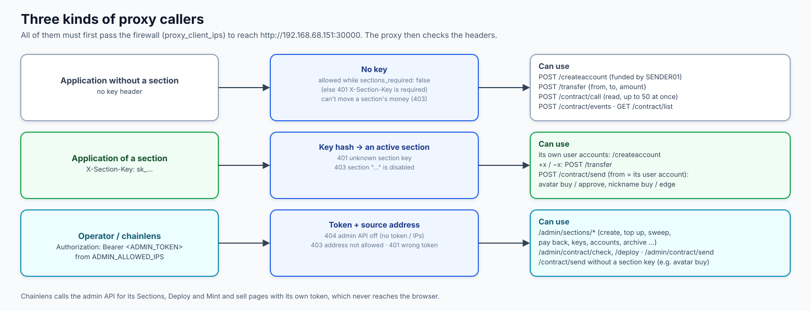

# Proxy API reference

> **What:** every endpoint of the proxy (`proxy/stress-latest.js`), with request bodies and answers.
>
> **For:** application developers and operators.
>
> **Related:** [proxy component](../components/proxy.md) · [sections](../features/sections.md) ·
> [NFT workflow](../features/nft-workflow.md) · [nicknames](../features/nicknames.md) · [glossary](../glossary.md)

**Contents**

- [Conventions](#conventions)
- [Accounts and transfers](#accounts-and-transfers)
- [Section calls (`X-Section-Key`)](#section-calls-x-section-key)
- [Contracts](#contracts)
- [NFT collections](#nft-collections)
- [Nicknames](#nicknames)
- [Admin API: sections](#admin-api-sections)
- [Admin API: contracts and registry](#admin-api-contracts-and-registry)
- [Removed routes](#removed-routes)
- [Status and metrics](#status-and-metrics)
- [Errors](#errors)

---

## Conventions



| | |
|---|---|
| **Base URL** | `http://<proxy VIP>:30000` — production `http://192.168.68.151:30000` (the active proxy). Development: `http://localhost:30000` |
| **Body** | JSON, header `Content-Type: application/json` (limit 1 MB) |
| **Amounts** | ETH as a decimal string (`"1.5"`), never wei. Exception: raw ABI values in a list of `args` ([below](#arguments-a-list-or-an-object)) |
| **Addresses** | `0x…` (any letter case) |
| **Answers** | JSON. Success: `{ "success": true, … }`. Failure: an HTTP status and `{ "error": "…" }` |
| **Who may call** | the firewall's `proxy_client_ips` ([access control](../deployment/access-control.md)); the admin API also needs the admin token and an admin address |

Three kinds of callers:

| Caller | Header | Can use |
|---|---|---|
| Application **without** a section | none | `/createaccount` and `/transfer` with SENDER01, and the contract reads (`/contract/call`, `/contract/events`, `/contract/list`); all refused (401) when `sections_required: true` |
| Application **of a section** | `X-Section-Key: sk_…` | section calls: its own accounts, +x / −x transfers, contract reads and writes (NFT purchases, nicknames) |
| **Operator / chainlens** | `Authorization: Bearer <ADMIN_TOKEN>`, from `ADMIN_ALLOWED_IPS` | the `/admin/*` API, and `/contract/send` without a key |

```bash
# example
curl -s -X POST http://192.168.68.151:30000/createaccount \
  -H 'Content-Type: application/json' -H 'X-Section-Key: sk_…' \
  -d '{"amount":"2","pool":"none"}'
```

---

## Accounts and transfers

### `POST /createaccount` — new account (new MPC key)

The 3 MPC nodes run distributed key generation: the private key never exists. **Needs all 3 MPC
nodes online.**

| Field | | |
|---|---|---|
| `amount` | ETH | funding of the new account |
| `pool` | optional | presignature pool class: `big`, `small` (default, `MPC_NEW_ACCOUNT_POOL`) or `none`. `big` = fast signing for busy accounts |

- **With `X-Section-Key`:** the account is registered under the section on chain and funded from
  the section's **upfront** account.
- **Without a key:** funded by `SENDER01`.

```json
→ { "success": true, "section": { "id": 1, "name": "Shop A" }, "address": "0x…",
    "from": "<upfront account>", "amount": "2", "txHash": "0x…", "registryTxHash": "0x…" }
```

### `POST /account/pool` — change an account's pool class

`{ "address": "0x…", "pool": "big" | "small" | "none" }`

### `POST /transfer` — move ETH

**Section call** (`X-Section-Key`): the sign of `amount` sets the direction.

| Body | Direction |
|---|---|
| `{ "account": "0x…", "amount": "1", "memo": "optional" }` | **+x**: the user account → the section's **consumption** account |
| `{ "account": "0x…", "amount": "-0.5" }` | **−x**: the section's **upfront** account → the user account |

`account` must be a user account of that section.

```json
→ { "success": true, "section": {…}, "direction": "account -> consumption",
    "from": "0x…", "to": "0x…", "amount": "1", "txHash": "0x…" }
```

**Without a key:** `{ "from": "0x…", "to": "0x…", "amount": "1", "memo": "optional" }`.
A section's accounts can't be moved this way (403).

### `GET /transfer/:txHash` — status of a transfer

Status (pending, mined, failed) and the memo.

---

## Section calls (`X-Section-Key`)

The key identifies the section; the section must be **active**. Without a key, calls use SENDER01
unless `sections_required: true` (then 401). See [sections](../features/sections.md).

| Endpoint | With the section key |
|---|---|
| `POST /createaccount` | account of the section, funded from its upfront account |
| `POST /transfer` | +x / −x (above) |
| `POST /contract/send` | a contract transaction signed by a user account of the section: also every NFT purchase and nickname write ([below](#contracts)) |
| `POST /contract/call`, `/contract/events`, `GET /contract/list` | reads; the key is needed only when `sections_required: true` |

---

## Contracts

One API for every contract registered in the SectionRegistry (deployed by the contract account
center), and only for the functions and events of its ABI. The platform's own contracts (the NFT
collection version 3 and the nickname collection) use the same calls, with friendly values.

| Endpoint | Does | Caller |
|---|---|---|
| `POST /contract/call` | read: a view / pure function (`eth_call`), or up to 50 at once | anyone allowed (section key when `sections_required: true`) |
| `POST /contract/send` | write: a transaction signed by a **user account of the caller's section** | `X-Section-Key`, or the admin token |
| `POST /contract/events` | the contract's events, filtered, newest first | as `/contract/call` |
| `GET /contract/list` | the registered contracts | as `/contract/call` |
| `POST /admin/contract/send` | write signed by the **contract account center** (minter and owner of the platform's contracts) | admin token ([below](#post-admincontractsend--write-as-the-contract-account-center)) |

`contract` is the contract's address. `function` is a name, or the full signature
(`transfer(address,uint256)`) when the name is overloaded.

### Arguments: a list or an object

| `args` | Means | Example |
|---|---|---|
| a **list** | the raw ABI values in order: wei, `bytes3` hex, token ids… | `"args": ["1"]` |
| an **object** | the values **by name** (the ABI's input names; a leading or trailing `_` is ignored) | `"args": { "tokenId": "1" }` |
| left out | no arguments | |

Numbers may be strings or numbers, addresses `0x…`, booleans `true` / `false`, arrays and tuples
as JSON. With an object on the **platform's contracts**, the values are **friendly**: prices in
ETH, colors `#rrggbb`, pattern names, metadata for a mint ([table below](#friendly-values-of-the-platform-contracts)).
On other contracts an object only puts the values in the ABI's order.

- A missing or misnamed value: 400 `args: no value for "account" (quote(address,uint8)); given: acct`.
- An unknown name on another contract: 400 `args: unknown name(s) x; f(uint256) takes a, b`.
- Nicknames are always trimmed and NFC-normalized, also in a list.

### `POST /contract/call` — read

```json
{ "contract": "0xCollection", "function": "priceOf", "args": { "tokenId": "1" } }
→ { "success": true, "contract": "0xCollection", "function": "priceOf(uint256)",
    "result": { "tokenId": "1", "price": "0.3" },
    "outputs": [ { "name": "0", "type": "uint256", "value": "300000000000000000" } ] }
```

`result` is the friendly value. `outputs` are the raw ABI values.

**Batch:** `{ "calls": [ { contract, function, args }, … ] }`, 1 to 50 reads, on any contracts.
Each one is answered or fails on its own; `success` is true only when all succeeded.

```json
{ "calls": [
    { "contract": "0xCollection", "function": "ownerOf", "args": { "tokenId": "1" } },
    { "contract": "0xCollection", "function": "ownerOf", "args": ["77"] },
    { "contract": "0xCollection", "function": "name" } ] }
→ { "success": false, "results": [
    { "success": true, "function": "ownerOf(uint256)", "result": { "tokenId": "1", "owner": "0xUser" }, "outputs": […], … },
    { "success": false, "status": 400, "error": "call reverted: not minted" },
    { "success": true, "function": "name()", "result": "Dragons", "outputs": […], … } ] }
```

### `POST /contract/send` — write

Signed by `from`, a user account of the caller's section. Waits for the block. `value` in ETH, only
for payable functions.

```json
{ "contract": "0x…", "function": "transfer(address,uint256)", "args": ["0xTo", "5"], "from": "0xUser", "value": "0" }
→ { "success": true, "section": { "id": 1, "name": "Shop A" }, "contract": "0x…", "function": "transfer(address,uint256)",
    "from": "0xUser", "value": "0.0", "txHash": "0x…", "blockNumber": 123, "gasUsed": 51234,
    "result": null, "events": [ { "name": "Transfer", "args": {…} } ] }
```

`result` is the friendly result of the platform's contracts (a sale, a nickname…), `null` on other
contracts. `events` are the contract's decoded events. A transaction mined but reverted answers 400
with `success: false`.

- **Caller:** `X-Section-Key`, or the admin token from `ADMIN_ALLOWED_IPS` without a key (as chainlens
  does): the section is then the section of `from`, which must be a user account of an active section.
- **Payee:** an `address` input named `payee` is set to the sender's section's **consumption** account
  when left out. Another address → 400.
- **Price:** for the platform functions below, a left-out `value` is filled in with the price.
  Another value → 400.
- **Metrics:** the section's operations are counted from the events: `NicknameBought` → `nickname_sale`,
  `EdgeUpgraded` → `edge_upgrade`, `Sold` → `nft_first_sale` (seller = the contract account center)
  or `nft_resale`.

| Contract | Function, `args` | `value` filled in | Checks before sending | Event |
|---|---|---|---|---|
| nickname collection | `buyNickname`, `{ nickname }` | `nicknamePrice` | trimmed + NFC, 1–256 characters, no control characters or `< > & " ' \` (400); one per account, taken, reserved (409) | `NicknameBought {tokenId, buyer, nickname, price, paidTo}` |
| nickname collection | `upgradeEdge`, `{ level }` | `quote(from, level)` (sum of the step prices) | level 1 or more (400); has a nickname (404); level exists, open, above the current one (400 `level N: …`) | `EdgeUpgraded {tokenId, owner, fromLevel, toLevel, price, paidTo}` |
| NFT collection | `buy`, `{ tokenId }` | `priceOf(tokenId)` | token exists (404); `from` doesn't own it already (400) | `Sold {tokenId, seller, buyer, price, paidTo}` |
| NFT collection | `approve`, `{ tokenId }` from the seller | — | — | `Approval` |

`mint` can't be sent this way (only the center mints, `not minter`): use
[`POST /admin/contract/send`](#post-admincontractsend--write-as-the-contract-account-center).

### `POST /contract/events` — events

```json
{ "contract": "0xCollection", "event": "Transfer", "where": { "to": "0xUser" }, "current": true }
→ { "success": true, "contract": "0xCollection", "event": "Transfer(address,address,uint256)",
    "fromBlock": 37567, "toBlock": 37592, "count": 1, "complete": true,
    "events": [ { "name": "Transfer", "args": { "from": "0xSeller", "to": "0xUser", "tokenId": "1" },
                  "blockNumber": 37590, "txHash": "0x…", "logIndex": 0, "time": "2026-11-23T12:20:15.000Z" } ] }
```

| Field | |
|---|---|
| `event` | the event's name (or signature); a wrong one answers 400 with the list |
| `where` | `{ arg: value }`. On an **indexed** argument the chain filters; on another one, the proxy after decoding |
| `fromBlock`, `toBlock` | default: from the contract's registration to the latest block |
| `limit` | default 100, at most 1000. The newest events first |
| `current` | `true` only with event `Transfer` and `where.to`: keeps the tokens that address **still owns** (one event per token) |

`complete: false` means the limit was reached: older events exist. On the platform's contracts
`price` and `stepPrice` are in ETH.

### `GET /contract/list` — registered contracts

| Query | Keeps |
|---|---|
| `?type=nft` / `nickname` / `contract` | NFT collections, nickname collections, other contracts |
| `?kind=common` / `nft` | the registry kind |
| `?has=buyNickname` | contracts with this function |
| `?q=drag` | name contains (any case) |
| `?functions=1` | adds each contract's `functions` (signature, mutability) and `events` |

```json
→ { "success": true, "contracts": [
    { "address": "0xCollection", "name": "Dragons", "type": "nft", "kind": "nft", "registeredIn": 14172,
      "symbol": "DRG", "minter": "<contract account center>" },
    { "address": "0xNicknames", "name": "Nicknames", "type": "nickname", "kind": "common", "registeredIn": 35444,
      "symbol": "NICK", "minter": "<contract account center>", "current": true } ] }
```

Oldest first. `current: true` marks the nickname collection in use (the latest registered one).

### Friendly values of the platform contracts

**Arguments** (`args` as an object). *Center* = only with `/admin/contract/send`.

| Contract | Function | `args` |
|---|---|---|
| NFT | `buy` | `{ tokenId }` (payee and price filled in) |
| NFT | `approve` | `{ tokenId }`: puts the token up for sale (approves the collection itself; `to` to approve another address) |
| NFT | `priceOf`, `ownerOf`, `tokenURI`, `getApproved` | `{ tokenId }` |
| NFT | `balanceOf` | `{ owner }` |
| NFT | `mint` (center) | `{ name, image, description, attributes, properties, price }`: `name` and `image` required, `price` in ETH (default 0). The owner (the center), the next token id and the on-chain metadata URI are filled in |
| nickname | `buyNickname` | `{ nickname }` |
| nickname | `upgradeEdge` | `{ level }` |
| nickname | `quote` | `{ account, level }` |
| nickname | `isAvailable`, `idOf` | `{ nickname }` |
| nickname | `nicknameOf`, `balanceOf` | `{ account }` |
| nickname | `edgeInfo` | `{ level }` |
| nickname | `tokenURI`, `ownerOf`, `edgeOf`, `nicknameById`, `locked`, `reserved` | `{ tokenId }` |
| nickname | `setNicknamePrice` (center) | `{ price }` (ETH) |
| nickname | `addEdge` (center) | `{ name, price, color, color2, width, radius, pattern }`: `name`, `price` and `color` required |
| nickname | `setEdge` (center) | `{ level, …only the fields to change }` (also `enabled`) |
| nickname | `reserve` (center) | `{ nicknames: [ … ], reserved }`: 1 to 100 names; `reserved: false` frees them |

Edge style values: `color`, `color2` `#rrggbb`; `width` 1–20; `radius` 0–40; `pattern` `solid`,
`double`, `dashed`, `gradient` or `glow`; `name` 1–32 bytes. Defaults for `addEdge`: `color2` =
`color`, width 3, radius 12, `solid`.

**Results** (`result`):

| Contract | Function | `result` |
|---|---|---|
| NFT | `priceOf` | `{ tokenId, price }` |
| NFT | `ownerOf` | `{ tokenId, owner }` |
| NFT | `tokenURI` | `{ tokenId, metadata, image }` |
| NFT | `balanceOf` | `{ owner, tokens }` |
| NFT | `buy` | `{ sale: "first sale" \| "resale", tokenId, seller, buyer, price, paidTo }` |
| NFT | `mint` | `{ minted, tokenId, owner, price, metadata }` |
| NFT | `approve` | `{ tokenId, approved, forSale }` (`forSale`: approved to the collection) |
| nickname | `nicknamePrice` | `{ price }` |
| nickname | `edgeCount` | `{ count, edges: [ { level, name, price, enabled, style: { color, color2, width, radius, pattern } } ] }` |
| nickname | `edgeInfo` | one edge `{ level, name, price, enabled, style }` |
| nickname | `quote` | `{ account, level, price }`: the sum of the step prices up to `level` |
| nickname | `isAvailable` | `{ nickname, characters, tokenId, available, reason }` (`reason`: `taken`, `reserved` or `null`) |
| nickname | `idOf` | `{ nickname, tokenId }` |
| nickname | `nicknameOf` | `{ nickname, tokenId, account, level, edge, image }` (`image`: SVG data URI), or `{ account, nickname: null }` |
| nickname | `edgeOf` | `{ tokenId, level, edge }` |
| nickname | `tokenURI` | `{ tokenId, metadata, image }` |
| nickname | `ownerOf` | `{ tokenId, owner }` |
| nickname | `buyNickname`, `upgradeEdge` | the nickname details (as `nicknameOf`) + `price`, `paidTo` |
| nickname | `setEdge`, `addEdge` | `{ edge }` |
| nickname | `setNicknamePrice` | `{ nicknamePrice }` |
| nickname | `reserve` | `{ reserved, nicknames }` |
| any other | a read | the one value, or an object of the named values; JSON data URIs decoded |

Prices are in ETH.

### Errors of the contract calls

| Status | Message (start) |
|---|---|
| 400 | `contract: a contract address` |
| 404 | `0x… is not a registered contract` |
| 400 | `function "x" is not in the contract's ABI` / `several functions have this name, give the signature …` |
| 400 | `… changes state: use POST /contract/send` / `… only reads: use POST /contract/call` |
| 400 | `args: no value for "…" (…); given: …` / `args: unknown name(s) …` / `args: a list (raw ABI values) or an object (by name)` |
| 400 | friendly values: `price: ETH, e.g. "0.5"`, `color: a color #RRGGBB`, `pattern: solid, double, …`, `nicknames: a list of 1 to 100 nicknames` |
| 404 | `level: no edge level 40 (levels 0-3)` (`setEdge`) |
| 400 | `call reverted: …` (a read) / `calls: a list of 1 to 50 reads …` |
| 400 | `event: one of …` / `where: Sold has no argument …` / `current: only with event Transfer and where.to …` |
| 400 | `payee: the consumption account of section "…" (0x…); leave it out to fill it in` |
| 400 | `value: the price is X ETH (leave "value" out to pay it)` / `… is not payable: send no value` |
| 400 | `insufficient balance: X ETH is needed` |
| 400 | `the transaction would revert: …` (refused before signing, with the contract's reason) |
| 401 | `X-Section-Key is required: …` (no key and not the admin caller) |
| 403 | `… is not a user account of a section` / `section "…" is disabled` |

---

## NFT collections

The platform's collection is **NftCollection version 3** ([`NftCollection.sol`](../../proxy/contracts/NftCollection.sol)):
deployed and minted by the **contract account center**, registered in the SectionRegistry (kind NFT),
shared by all sections. The price is set at mint and fixed for every sale. A sale is one `buy`
signed by the buyer: the token and the ETH move together or not at all.

| Task | Call |
|---|---|
| list the collections | `GET /contract/list?type=nft` |
| deploy one | `POST /admin/contracts/deploy` `{ "template": "nft-collection", "name", "symbol" }` |
| mint for sale | `POST /admin/contract/send` `mint` `{ name, image, description, attributes, price }` |
| first sale | `POST /contract/send` `buy` `{ tokenId }`, `from` = the buyer: the price goes to the buyer's section's **consumption** account |
| resale | the seller sends `approve` `{ tokenId }`, then the buyer sends `buy` `{ tokenId }`: the price goes to the **seller** |
| tokens an account owns | `POST /contract/events` `Transfer`, `where: { to }`, `current: true` |
| a token's details | `POST /contract/call` batch: `ownerOf`, `priceOf`, `tokenURI` |
| a token's mint transaction | `POST /contract/events` `Transfer`, `where: { from: 0x0…0, tokenId }` |
| the sales | `POST /contract/events` `Sold` |

**Version-2 collections** (minted by SENDER01) are **retired**: the proxy no longer reads, mints or
sells them. They stay on the chain.

```bash
P=http://192.168.68.151:30000; T=<admin token>; K=<section key>
# deploy (names and symbols unique among the NFT collections, any case; else 409)
curl -s -X POST $P/admin/contracts/deploy -H "Authorization: Bearer $T" -H 'Content-Type: application/json' \
  -d '{"template":"nft-collection","name":"Dragons","symbol":"DRG"}'
# → { "success": true, "name": "Dragons", "kind": "nft", "address": "0xCollection", "txHash": "0x…", "codeCheck": "matches the artifact", … }

# mint (the center mints to itself, for sale)
curl -s -X POST $P/admin/contract/send -H "Authorization: Bearer $T" -H 'Content-Type: application/json' \
  -d '{"contract":"0xCollection","function":"mint","args":{"name":"Red dragon","image":"https://example.com/red.png","description":"Level 1","attributes":[{"trait_type":"level","value":"1"}],"price":"0.3"}}'
# → { "success": true, "function": "mint(address,uint256,string,uint256)", "txHash": "0x…",
#     "result": { "minted": true, "tokenId": "1", "owner": "<center>", "price": "0.3", "metadata": { "name": "Red dragon", … } }, … }

# first sale (the buyer: a user account of the key's section)
curl -s -X POST $P/contract/send -H "X-Section-Key: $K" -H 'Content-Type: application/json' \
  -d '{"contract":"0xCollection","function":"buy","args":{"tokenId":"1"},"from":"0xUser"}'
# → { "success": true, "value": "0.3", "txHash": "0x…",
#     "result": { "sale": "first sale", "tokenId": "1", "seller": "<center>", "buyer": "0xUser", "price": "0.3", "paidTo": "<consumption account>" }, "events": [ … ] }

# resale: the seller's section puts it up for sale, then the buyer's section buys
curl -s -X POST $P/contract/send -H "X-Section-Key: $K" -H 'Content-Type: application/json' \
  -d '{"contract":"0xCollection","function":"approve","args":{"tokenId":"1"},"from":"0xUser"}'
# → { …, "result": { "tokenId": "1", "approved": "0xCollection", "forSale": true } }
curl -s -X POST $P/contract/send -H "X-Section-Key: $K2" -H 'Content-Type: application/json' \
  -d '{"contract":"0xCollection","function":"buy","args":{"tokenId":"1"},"from":"0xBuyer"}'
# → { …, "result": { "sale": "resale", "tokenId": "1", "seller": "0xUser", "buyer": "0xBuyer", "price": "0.3", … } }

# what 0xBuyer owns, and token 1 in one batch
curl -s -X POST $P/contract/events -H "X-Section-Key: $K" -H 'Content-Type: application/json' \
  -d '{"contract":"0xCollection","event":"Transfer","where":{"to":"0xBuyer"},"current":true}'
curl -s -X POST $P/contract/call -H "X-Section-Key: $K" -H 'Content-Type: application/json' \
  -d '{"calls":[{"contract":"0xCollection","function":"ownerOf","args":{"tokenId":"1"}},{"contract":"0xCollection","function":"priceOf","args":{"tokenId":"1"}},{"contract":"0xCollection","function":"tokenURI","args":{"tokenId":"1"}}]}'
# → results: { "tokenId": "1", "owner": "0xBuyer" }, { "tokenId": "1", "price": "0.3" }, { "tokenId": "1", "metadata": {…}, "image": "https://example.com/red.png" }
# the mint transaction of token 1
curl -s -X POST $P/contract/events -H "X-Section-Key: $K" -H 'Content-Type: application/json' \
  -d '{"contract":"0xCollection","event":"Transfer","where":{"from":"0x0000000000000000000000000000000000000000","tokenId":"1"}}'
```

Token ids start at 1 in each collection. The metadata is stored on chain in the token URI (JSON; one
that doesn't fit in a block: 400 `metadata is too large for the chain`). Seller and buyer may be in different sections: each section signs only for its own
accounts. Step by step from Remix to a sale: [NFT workflow](../features/nft-workflow.md).

---

## Nicknames

Soulbound nickname tokens with an edge level ([nicknames](../features/nicknames.md)), in the
**nickname collection**: a registered contract deployed by the center. Find it with
`GET /contract/list?type=nickname` (the one with `current: true`). Prices in ETH. Writes are signed by
a user account of the caller's section.

| Task | Call | `result` |
|---|---|---|
| edge levels | `POST /contract/call` `edgeCount` | `{ count, edges: [ … ] }` |
| nickname price | `POST /contract/call` `nicknamePrice` | `{ price }` |
| is a name free | `POST /contract/call` `isAvailable` `{ nickname }` | `{ nickname, characters, tokenId, available, reason }` |
| an account's nickname | `POST /contract/call` `nicknameOf` `{ account }` | `{ nickname, tokenId, account, level, edge, image }` or `{ account, nickname: null }` |
| price of a level | `POST /contract/call` `quote` `{ account, level }` | `{ account, level, price }` |
| buy | `POST /contract/send` `buyNickname` `{ nickname }`, `from` | the nickname + `price`, `paidTo` |
| raise the edge | `POST /contract/send` `upgradeEdge` `{ level }`, `from` | the nickname + `price`, `paidTo` |
| all purchases | `POST /contract/events` `NicknameBought` (or `EdgeUpgraded`) | |

```bash
curl -s -X POST $P/contract/call -H "X-Section-Key: $K" -H 'Content-Type: application/json' \
  -d '{"calls":[{"contract":"0xNicknames","function":"edgeCount"},{"contract":"0xNicknames","function":"nicknamePrice"},{"contract":"0xNicknames","function":"isAvailable","args":{"nickname":"  Alice "}}]}'
# → results: { "count": 4, "edges": [ { "level": 0, "name": "Simple", "price": "0", "enabled": true, "style": { "color": "#94a3b8", … } }, … ] },
#            { "price": "1" }, { "nickname": "Alice", "characters": 5, "tokenId": "…", "available": true, "reason": null }
curl -s -X POST $P/contract/send -H "X-Section-Key: $K" -H 'Content-Type: application/json' \
  -d '{"contract":"0xNicknames","function":"buyNickname","args":{"nickname":"Alice"},"from":"0xUser"}'
# → { "success": true, "value": "1.0", …, "result": { "nickname": "Alice", "tokenId": "…", "account": "0xUser", "level": 0,
#     "edge": "Simple", "image": "data:image/svg+xml;base64,…", "price": "1", "paidTo": "<consumption account>" } }
```

Names: 1–256 characters after NFC and trimming, no control characters and none of `< > & " ' \`,
unique without regard to A–Z case, one per account. The level only goes up. Admin writes (price,
levels, reserved names) go through [`POST /admin/contract/send`](#post-admincontractsend--write-as-the-contract-account-center).

---

## Admin API: sections

`Authorization: Bearer <ADMIN_TOKEN>` (Ansible: `state/secrets/proxy_admin_token`) from
`ADMIN_ALLOWED_IPS` (operator and the chainlens host). Usually used through the chainlens
**Sections** page. Writes go to the on-chain SectionRegistry, signed by the registry admin key.

| Endpoint | Body | Does |
|---|---|---|
| `GET /admin/sections` | `?fresh=1` (skip the 10 s cache), `?archived=1` | all sections, accounts, balances, info |
| `GET /admin/sections/:id` | | one section |
| `POST /admin/sections` | `{ "name": "…", "info": {…} }` | create: 3 MPC keys (**all 3 MPC nodes** needed), registry entry. The API key `sk_…` is in this answer **only**. No funding |
| `POST /admin/sections/:id/name` | `{ "name": "Shop A" }` | rename |
| `POST /admin/sections/:id/info` | `{ "key": "contact", "value": "…" }` | set an info field (`""` removes it) |
| `POST /admin/sections/:id/key` | | new API key; the old one stops at once |
| `POST /admin/sections/:id/active` | `{ "active": false }` | disable / enable (a disabled section's calls are refused) |
| `POST /admin/sections/:id/topup` | `{ "amount": "100" }` | SENDER01 → upfront |
| `POST /admin/sections/:id/sweep` | `{ "amount": "all" }` | consumption → payment (`"all"` or ETH) |
| `POST /admin/sections/:id/payback` | `{ "amount": "all" }` | payment → SENDER01 |
| `POST /admin/sections/:id/account` | `{ "role": "payment" }` | replace a role's account with a new MPC key; the balance moves to it |
| `POST /admin/sections/:id/archive` | `{ "confirm": "<name>" }` | all money back to SENDER01, section closed for good (history stays) |
| `GET /admin/sections/:id/accounts` | | the section's user accounts |
| `POST /admin/sections/:id/accounts` | `{ "amount": "5", "pool": "small" }` | create a user account (as `/createaccount`) |
| `POST /admin/sections/:id/transfer` | `{ "account", "amount", "memo" }` | +x / −x for a user account (as `/transfer`) |

Every money movement carries a memo naming the operation.

---

## Admin API: contracts and registry

Admin token, as above.

| Endpoint | Body | Does |
|---|---|---|
| `GET /admin/contracts` | | the center's address and the registered contracts |
| `POST /admin/contracts/check` | a template, or `{ "kind": "common" \| "nft", "name", "abi", "bytecode", "deployedBytecode", "immutableReferences", "args" }` | dry run: arguments, gas, the future address; nothing signed |
| `POST /admin/contracts/deploy` | same | deploy as the contract account center, compare the code, register with the ABI |
| `POST /admin/contract/send` | `{ "contract", "function", "args", "value" }` | a write signed by the contract account center ([below](#post-admincontractsend--write-as-the-contract-account-center)) |
| `GET /admin/nickname` | `?q=` (search) | the nickname collection, price, edge levels with holder counts, nicknames (up to 200): the chainlens **Nicknames** page |
| `POST /admin/registry/migrate` | `{ "from": "0xOldRegistry" }` | copy sections from a version-1 registry (Ansible `08-check.yml` runs it) |

```json
→ { "success": true, "name": "Dragons", "kind": "nft", "address": "0x…", "deployer": "<center>", "txHash": "0x…",
    "blockNumber": 37570, "gasUsed": 1408380, "codeCheck": "matches the artifact", "registryTxHash": "0x…" }
```

### Templates

The platform's own contracts are compiled into the proxy image. `check` and `deploy` take a
template instead of `abi` and `bytecode`; the registry's address is filled in.

| Template | Body | Registered as |
|---|---|---|
| `nft-collection` | `{ "template": "nft-collection", "name": "Dragons", "symbol": "DRG" }` (both required). Names and symbols are unique among the NFT collections, any case: else 409 | kind NFT |
| `nickname-collection` | `{ "template": "nickname-collection", "name": "Nicknames", "symbol": "NICK", "price": "1", "edge0": "Simple", "another": false }` (these values are the defaults, except `price`: default 0) | common |

A second nickname collection is refused (409 `a nickname collection exists at 0x… (send "another": true …)`)
unless `"another": true`: the new one is used from then on. An unknown template: 400
`template: nft-collection or nickname-collection (or no template: abi and bytecode)`.

### `POST /admin/contract/send` — write as the contract account center

Same body as `/contract/send`, without `from`: the contract account center signs (the minter and
owner of the platform's contracts). Any registered contract; friendly `args` and `result` as in
[the table](#friendly-values-of-the-platform-contracts).

| Function | `args` |
|---|---|
| `mint` (NFT) | `{ "name", "image", "description", "attributes", "properties", "price": "0.5" }` |
| `setNicknamePrice` | `{ "price": "1" }` (new buyers) |
| `addEdge` | `{ "name": "Gold", "price": "1", "color": "#f59e0b", "color2": "#fde68a", "width": 6, "radius": 20, "pattern": "gradient" }` |
| `setEdge` | `{ "level": 2, "color": "#ff0000" }`: only the fields to change; existing nicknames redraw. Level 0 keeps price 0 and stays enabled |
| `reserve` | `{ "nicknames": ["admin"], "reserved": true }` (up to 100; `false` frees them) |

```json
{ "contract": "0xNicknames", "function": "setEdge", "args": { "level": 1, "color": "#ff0000" } }
→ { "success": true, "function": "setEdge(uint8,string,uint256,bool,bytes3,bytes3,uint8,uint8,uint8)", "from": "<center>",
    "txHash": "0x…", "result": { "edge": { "level": 1, "name": "Silver", "price": "0.5", "enabled": true,
    "style": { "color": "#ff0000", "color2": "#64748b", "width": 4, … } } }, "events": [ … ] }
```

A revert answers 400 (`the transaction would revert: …` before signing, `reverted in block N` after).

---

## Removed routes

These routes answer **410**; the message names the call that replaces each. `0xCollection` and
`0xNicknames` are the contract addresses from `GET /contract/list`.

| Removed | Use |
|---|---|
| `POST /nft/deploy` | `POST /admin/contracts/deploy` `{ "template": "nft-collection", "name", "symbol" }` |
| `POST /nft/mint` | `POST /admin/contract/send` `mint` `{ name, image, price, … }` |
| `POST /nft/transfer` | `POST /contract/send` `buy` `{ tokenId }`, `from` = the buyer (a resale: the seller first sends `approve` `{ tokenId }`). Version-2 collections are retired |
| `GET /nft/contract`, `GET /nft/collections` | `GET /contract/list?type=nft` |
| `GET /nft/owner/:address` | `POST /contract/events` `Transfer`, `where: { to: address }`, `current: true` |
| `GET /nft/:tokenId/metadata` | `POST /contract/call` `tokenURI` `{ tokenId }` (`result.metadata`) |
| `GET /nft/:tokenId` | `POST /contract/call` batch `ownerOf`, `priceOf`, `tokenURI`; the mint: `POST /contract/events` `Transfer` from `0x0` |
| `GET /nickname/edges` | `POST /contract/call` `edgeCount` (`result.edges`) and `nicknamePrice`; the collection: `GET /contract/list?type=nickname` |
| `GET /nickname/check` | `POST /contract/call` `isAvailable` `{ nickname }` |
| `GET /nickname/of/:account` | `POST /contract/call` `nicknameOf` `{ account }` |
| `GET /nickname/quote` | `POST /contract/call` `quote` `{ account, level }` |
| `POST /nickname/buy` | `POST /contract/send` `buyNickname` `{ nickname }`, `from` |
| `POST /nickname/edge` | `POST /contract/send` `upgradeEdge` `{ level }`, `from` |
| `POST /admin/nickname/deploy` | `POST /admin/contracts/deploy` `{ "template": "nickname-collection", … }` |
| `PUT /admin/nickname/price` | `POST /admin/contract/send` `setNicknamePrice` `{ price }` |
| `POST /admin/nickname/edges` | `POST /admin/contract/send` `addEdge` `{ name, price, color, … }` |
| `PUT /admin/nickname/edges/:level` | `POST /admin/contract/send` `setEdge` `{ level, …changes }` |
| `POST /admin/nickname/reserve` | `POST /admin/contract/send` `reserve` `{ nicknames, reserved }` |

```json
GET /nft/collections
→ 410 { "error": "GET /nft/collections was removed: use GET /contract/list?type=nft" }
```

`GET /admin/nickname` stays.

---

## Status and metrics

| Endpoint | Answer |
|---|---|
| `GET /status/senders` | per sender: next nonce vs Besu, value in flight, nonce gaps and stalls, corrections by the background chain check |
| `GET /metrics` | Prometheus format: senders, sections, HTTP requests and latency per route, process, Redis link. Optional `METRICS_TOKEN` (Bearer). Scraped by [monitoring](../components/monitoring.md) |

---

## Errors

| Status | Typical cause |
|---|---|
| 400 | bad input: missing field, bad amount or address, function not in the ABI, a missing `args` value, "the transaction would revert: …" |
| 401 | `X-Section-Key is required`, unknown section key, wrong admin token |
| 403 | the account is not a user of that section, disabled section, admin API from a non-admin address |
| 404 | unknown contract, token, edge level or section |
| 409 | collection name or symbol already used; a nickname taken, reserved, or the account already has one; a nickname collection exists |
| 410 | a removed route ([above](#removed-routes)) |
| 500 / 502 / 503 / 504 | the signer, Besu or the registry did not answer, or a transaction was not mined in time; see the proxy log and [troubleshooting](../operations/troubleshooting.md) |
